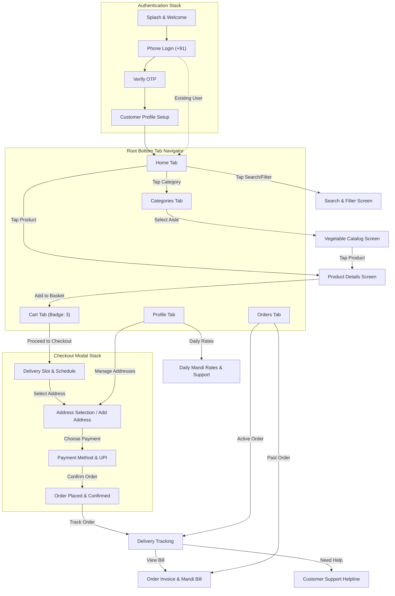

# Design System & Screen Specifications: Balaji Fresh Delivery App
**Stitch Project ID:** `8350282291516773685`  
**Stitch Project URL:** [https://stitch.google.com/projects/8350282291516773685](https://stitch.google.com/projects/8350282291516773685)  
**Target Platform:** Mobile (iOS & Android)  
**Target Technology:** React Native (with TypeScript, React Navigation v6/v7, and NativeWind/StyleSheet)

---

## 1. Visual Theme & Atmosphere

The design system is centered on **Modern Organic Functionalism**, crafted specifically for multi-generational Indian households (elderly homemakers, busy parents, and young working professionals).

### Brand Personality & Mood
- **Farm-Fresh & Crisp:** Crisp, clean, dewy morning vegetable mandi aesthetics without corporate sterile vibes.
- **Wholesome & Trustworthy:** Direct-from-farmer transparency, morning harvest timestamps (e.g. *Harvested 4:30 AM*), daily wholesale mandi rates, digital tare-weight guarantee.
- **Accessible & Frictionless:** High contrast, 48px+ touch targets, dual-language labels (English + Gujarati/Hindi names like *Tamatar / ટામેટા*, *Bhindi / ભીંડા*), phone OTP login with zero password barriers, and prominent voice search affordances.

---

## 2. Color Palette & Functional Roles

The palette is derived from Material Design 3 tokens extended for Indian grocery retail with high daylight legibility.

### Primary Colors (Botanical Greens)
| Token Name | Hex Code | Functional Role |
| :--- | :--- | :--- |
| `primary` | `#0D631B` | Deep leaf green for high-emphasis CTAs, active tab labels, primary brand text |
| `primary-container` | `#2E7D32` | Medium fresh green for button fills, card highlights, and brand badges |
| `primary-fixed` | `#A3F69C` | Light mint green for active pill chips, secondary badges, selection rings |
| `primary-fixed-dim` | `#88D982` | Subtle pastel green for muted badge fills and progress bar backgrounds |
| `on-primary` | `#FFFFFF` | Text/icon color over primary fills |
| `on-primary-container`| `#CBFFC2` | Soft mint text over dark green container backgrounds |
| `on-primary-fixed` | `#002204` | Very dark green text for maximum contrast on mint badges |

### Secondary Colors (Harvest Sunlight & Deals)
| Token Name | Hex Code | Functional Role |
| :--- | :--- | :--- |
| `secondary` | `#855300` | Rich amber/brown for price callouts and deal tags |
| `secondary-container`| `#FEA619` | Vibrant harvest orange for urgency badges ("TODAY'S RATE", savings tags, cart count badge) |
| `secondary-fixed` | `#FFDDB8` | Warm cream/peach for soft promo callouts and driver slot badges |
| `on-secondary` | `#FFFFFF` | Text on secondary buttons |
| `on-secondary-container`| `#684000`| Deep brown-gold text over orange container chips |

### Tertiary & Semantic Colors
| Token Name | Hex Code | Functional Role |
| :--- | :--- | :--- |
| `tertiary` | `#006329` | Deep botanical green for confirmed statuses and QC verified seals |
| `tertiary-container`| `#007F36` | Medium green for success states ("Order Confirmed", "Unlocked") |
| `tertiary-fixed` | `#7FFC97` | Bright spring green for morning harvest timestamps ("Updated 6:00 AM") |
| `error` | `#BA1A1A` | Alert crimson for destructive actions, wishlist hearts, cancellations |
| `error-container` | `#FFDAD6` | Soft blush background for error warnings and cancellation notices |
| `on-error` | `#FFFFFF` | High-contrast white on alert banners |

### Neutral Surfaces & Backgrounds
| Token Name | Hex Code | Functional Role |
| :--- | :--- | :--- |
| `background` / `surface` | `#F8FAF5` | Crisp off-white tinted canvas preventing glare in outdoor sunlight |
| `surface-container-lowest` | `#FFFFFF` | Pure white for cards, bottom navigation sheet, modals, and input fields |
| `surface-container-low` | `#F2F4EF` | Subtle grey-green tint for secondary containers, chips, and inactive inputs |
| `surface-container` | `#ECEFEA` | Divider lines, icon circle backdrops, stepper count containers |
| `surface-container-high` | `#E7E9E4` | Border outlines and progress bar tracks |
| `on-surface` | `#191C1A` | Slate-charcoal for primary headings, product titles, and prices |
| `on-surface-variant` | `#40493D` | Muted olive-grey for secondary body text, subtitles, and packaging metadata |
| `outline` | `#707A6C` | Outlines, inactive icons, strikethrough MRP prices |
| `outline-variant` | `#BFCABA` | Hairline borders (0.5px - 1px) between table rows and card edges |

---

## 3. Typography System (Inter)

All text uses **Inter** with tabular figure spacing enabled for prices, kilograms, and weights.

| Style Token | Font Size | Line Height | Weight | Letter Spacing | Usage in App |
| :--- | :--- | :--- | :--- | :--- | :--- |
| `headline-xl` | 28px | 34px | 700 (Bold) | -0.02em | Welcome banners, Splash screen titles |
| `headline-lg` | 22px | 28px | 700 (Bold) | -0.01em | Product detail title, Section primary headers |
| `headline-md` | 18px | 24px | 600 (SemiBold) | -0.01em | Category names, Card section titles, Dialog headers |
| `body-lg` | 16px | 24px | 500 (Medium) | 0.00em | Important instructions, delivery addresses |
| `body-md` | 14px | 20px | 400 (Regular) | 0.00em | Standard descriptions, mandi origin notes |
| `body-sm` | 12px | 16px | 400 (Regular) | +0.01em | Metadata, secondary regional names (*Bhindi / ભીંડા*) |
| `label-lg` | 15px | 20px | 600 (SemiBold) | +0.01em | Button labels, primary input labels |
| `label-md` | 13px | 18px | 600 (SemiBold) | +0.02em | Weight pills, chip filters, table headers |
| `label-sm` | 11px | 14px | 700 (Bold) | +0.03em | All-caps badges ("TODAY'S RATE", "FREE DELIVERY") |
| `price-display` | 20px | 24px | 700 (Bold) | -0.02em | Currency rupee values (`₹38`), Total bill amount |

---

## 4. Spacing, Geometry & Shadows

### Spacing Scale (8pt Grid)
- `space-xs`: 4px (tight badge padding, icon gap)
- `space-sm`: 8px (standard element spacing, chip padding)
- `space-md`: 12px (card internal padding, form row gap)
- `space-lg`: 16px (screen margin, container gap)
- `space-xl`: 24px (section margins, header gap)
- `space-2xl`: 32px (major layout blocks)

### Corner Radius (Roundness)
- `rounded-sm`: 4px (micro badges, tag highlights)
- `rounded-md`: 8px (buttons, small image thumbnails)
- `rounded-lg`: 12px (form inputs, delivery slot cards)
- `rounded-xl`: 16px (product cards, modal drawers, banner cards)
- `rounded-2xl`: 24px (floating sticky trays, bottom sheet modals)
- `rounded-full`: 9999px (weight selector pills, avatars, circular action icons)

### Shadows & Elevation (React Native Elevation / iOS Shadow)
- **Level 0 (Flat):** Canvas background `#F8FAF5`
- **Level 1 (Card Elevation):**
  - iOS: `shadowColor: '#1E293B', shadowOffset: { width: 0, height: 2 }, shadowOpacity: 0.05, shadowRadius: 6`
  - Android: `elevation: 2`
  - Border: `1px solid rgba(191, 202, 186, 0.4)`
- **Level 2 (Interactive Floating):**
  - iOS: `shadowColor: '#0D631B', shadowOffset: { width: 0, height: 4 }, shadowOpacity: 0.08, shadowRadius: 10`
  - Android: `elevation: 4`
- **Level 3 (Sticky Bottom Bar & Modal Sheets):**
  - iOS: `shadowColor: '#191C1A', shadowOffset: { width: 0, height: -4 }, shadowOpacity: 0.08, shadowRadius: 16`
  - Android: `elevation: 8`

---

## 5. Screen Inventory & Specifications

The project contains **20 distinct mobile screens** covering end-to-end customer workflows:

### A. Onboarding & Authentication Flow
1. **Welcome & Splash (`WelcomeScreen`)**
   - *Screen ID:* `4fec4db92a3d412a88775a39830a10f1`
   - *Dimensions:* 390 × 884
   - *Key UI:* Balaji enterprise farm logo, early morning freshness illustration, feature bullets (Direct Wholesale, Zero Storage, Guaranteed Morning Slot), language selector pill (English / ગુજરાતી), "Get Started" CTA.
2. **Phone Login (`PhoneLoginScreen`)**
   - *Screen ID:* `5be70aa686bf4293a8685870a77d1028`
   - *Dimensions:* 390 × 884
   - *Key UI:* Top header with logo and language switch, morning mandi banner, high-contrast phone input with `+91` country flag, "Get OTP / Continue" button, secondary "Continue with WhatsApp" CTA.
3. **Verify OTP (`OtpVerifyScreen`)**
   - *Screen ID:* `fa01ef53c5fa42f997863133502eeafb`
   - *Dimensions:* 390 × 884
   - *Key UI:* 4-digit auto-advancing OTP box, timer countdown for resend, auto-detection status, senior-friendly "Verify & Proceed" CTA.
4. **Customer Profile Setup (`ProfileSetupScreen`)**
   - *Screen ID:* `7726a3eb301948f6b7d5aafbbb854a5a`
   - *Dimensions:* 390 × 884
   - *Key UI:* Full name input, preferred language choice (English / Gujarati / Hindi), household size chip selector (1-2 people, 3-4 family, 5+ joint family), save & start shopping button.

### B. Discovery & Catalog Flow
5. **Home - Fresh Morning Delivery (`HomeScreen`)**
   - *Screen ID:* `1b45ea095c1346549c6dbc781a6be792`
   - *Dimensions:* 390 × 1712 (scrollable)
   - *Key UI:* Fixed top header with location chip ("Delivering to Sector 14, Gurugram"), profile avatar, early morning slot indicator ("Tomorrow 8:00 AM - 12:00 PM"); Free delivery progress bar (₹180 / ₹249); Search bar with Voice mic button; Mandi price ticker banner; Horizontal Category scroll (Daily Essentials, Leafy Greens, Gourds, Root Veggies, Exotics); 2-column product grid with weight pills and stepper buttons; Balaji Freshness Pledge strip; Sticky active basket bar.
6. **Categories Directory - Mandi Aisles (`CategoriesScreen`)**
   - *Screen ID:* `3030084223384aecbcb11212731b7a6a`
   - *Dimensions:* 390 × 1909
   - *Key UI:* Search bar, 2-column large visual category cards with item counts and seasonal badges (e.g., "Winter Special", "Daily Staples", "Desi Greens"), wholesale price savings tags.
7. **Vegetable Catalog & Daily Rates (`CatalogScreen`)**
   - *Screen ID:* `69646d2e2ce9494585f8dfe14c1c84d2`
   - *Dimensions:* 390 × 1761
   - *Key UI:* Category filter tabs, sorting options (Price Low to High, Most Popular, Fresh Arrivals), 2-column item cards with daily mandi pricing, dual regional naming, weight selector pills.
8. **Search & Filter - Fresh Vegetables (`SearchScreen`)**
   - *Screen ID:* `b9641a25e4e24da797e7634729d77083`
   - *Dimensions:* 390 × 1588
   - *Key UI:* Live search input with recent search tags, voice search state modal, filter chips (Organic, Farm Desi, Leafy, Under ₹30/kg), zero-result fallback with suggested seasonal produce.
9. **Product Details - Fresh Tomatoes (`ProductDetailScreen`)**
   - *Screen ID:* `de8395162f8a4530bb1e7df9044929ed`
   - *Dimensions:* 390 × 1676
   - *Key UI:* High-res produce carousel, "Harvested Today 4:30 AM" badge, Grade-A quality tag, pricing row with daily savings breakdown, 4-tier weight pack selector (`250g`, `500g`, `1kg`, `2kg`), number of packets stepper, mandi sourcing details (Haryana partner farms, ventilated paper bag packing), sticky bottom purchase bar.

### C. Cart, Delivery Slots & Payment Flow
10. **Cart & Easy Checkout (`CartScreen`)**
    - *Screen ID:* `ed28049ddd73455cb841a170b44d24b0`
    - *Dimensions:* 390 × 2049
    - *Key UI:* Free delivery unlocked banner, delivery slot summary card, delivery address card with "Change" action, itemized vegetable list with thumbnail, weight portion, price, quantity stepper, free kitchen gift ("Dhaniya & Hari Mirch Pack - Balaji Shagun"), bill summary breakdown (Item total, packing & sorting fee, delivery charge, savings total), payment method quick radio selector, sticky "Place Order • ₹238" button.
11. **11a - Delivery Slot & Schedule (`DeliverySlotScreen`)**
    - *Screen ID:* `3cf7d2b8e07643d28ddc8c78237817bc`
    - *Dimensions:* 390 × 1296
    - *Key UI:* Date tab selector (Today / Tomorrow / Day After), morning slot (`8:00 AM - 12:00 PM` - Early Harvest), evening slot (`4:00 PM - 8:00 PM`), slot cutoff timer ("Book within 2 hrs 14 mins for morning mandi run"), contactless delivery toggle.
12. **11b - Payment Method & UPI (`PaymentScreen`)**
    - *Screen ID:* `0047984ea65d48d4b4ca50fa2c2c65d0`
    - *Dimensions:* 390 × 1279
    - *Key UI:* UPI app grid (Google Pay, PhonePe, Paytm, BHIM, Cred), custom UPI ID input, Credit/Debit cards, Net Banking, and Cash on Delivery (COD) option with "Pay digitally on arrival" note.
13. **Add Delivery Address (`AddAddressScreen`)**
    - *Screen ID:* `fceab825a57f4e6b93ca35f5919bd69a`
    - *Dimensions:* 390 × 1434
    - *Key UI:* GPS map pin selector with "Use Current Location", House/Flat No, Apartment/Society Name, Street/Area, Landmark, Pincode auto-fill, Address label pills (Home, Work, Parents, Other), "Save & Deliver Here" CTA.

### D. Order Confirmation, Tracking & Invoice Flow
14. **Order Placed & Confirmed (`OrderConfirmedScreen`)**
    - *Screen ID:* `b5914f7334d7499f84d16e4aa387ba06`
    - *Dimensions:* 390 × 1597
    - *Key UI:* Animated green checkmark, order ID `#BE-89421`, delivery slot confirmation card, mandi harvest lock status, summary of items packed, "Track Morning Delivery" primary button, "Back to Home" secondary button.
15. **Live Morning Delivery Tracking (`DeliveryTrackingScreen`)**
    - *Screen ID:* `2619b3126a144e37a00a64fcc0baac97`
    - *Dimensions:* 390 × 1303
    - *Key UI:* Order header with verified badge, 4-step vertical progress tracker (Order Confirmed 7:15 PM -> Mandi Sorting & QC Active 5:00 AM -> Out for Doorstep Delivery 8:15 AM -> Delivered & Tare-Weighed), 100% Mandi Tare Weight Guarantee banner, Assigned Delivery Partner card (Driver Ramesh Kumar, 4.9 rating, van license plate HR 26 EA 4022, Call Partner and WhatsApp CTAs), crate items preview, expandable gate/guard delivery instructions sheet.
16. **Order Invoice & Mandi Bill (`InvoiceScreen`)**
    - *Screen ID:* `3aa69ab0988042109b8d085954b72b89`
    - *Dimensions:* 390 × 1726
    - *Key UI:* Mandi digital receipt header, GSTIN/FSSAI licensing numbers, itemized produce breakdown with tare weights, gross rate vs mandi discount, taxes & packing zero-rated callout, download PDF invoice action.

### E. Account, Profile & Support Flow
18. **My Orders & Morning Status (`OrdersListScreen`)**
    - *Screen ID:* `1c531bac0f5f42fc98175b1a04fd2404`
    - *Dimensions:* 390 × 1490
    - *Key UI:* Tabbed views (Active Orders / Past Orders), active order card with live ETA pill, past orders with 1-click "Reorder Morning Basket", invoice download button, rating trigger.
19. **Profile & Delivery Addresses (`ProfileScreen`)**
    - *Screen ID:* `dff0d80d5a13481cb4de1b4f5172e36c`
    - *Dimensions:* 390 × 1418
    - *Key UI:* Customer details header, saved address cards with edit/delete, notification preferences (Morning arrival WhatsApp alerts), language selector, help & mandi support direct line, logout action.
20. **Daily Mandi Rates & Support (`MandiRatesSupportScreen`)**
    - *Screen ID:* `8c8c40aea0354ae29895a66b73cb1021`
    - *Dimensions:* 390 × 1388
    - *Key UI:* Daily live wholesale rate sheet with yesterday vs today price comparison, mandi arrival trends, FAQ section regarding weighing scales, contact support via WhatsApp and phone.

---

## 6. Navigation Architecture & Screen Flow

---

## 7. Reusable Component Inventory (React Native)

To maintain consistency and 60fps performance across Android and iOS, the following components must be built as shared, atomic modules:

1. **`HeaderBar`**:
   - Location chip button with down arrow (opens address sheet).
   - Early morning slot ticker pill (`🌅 Next Delivery: Tomorrow 8:00 AM - 12:00 PM`).
   - Profile avatar icon with status dot.
2. **`BottomTabBar`**:
   - 5 tabs (`Home`, `Categories`, `Cart`, `Orders`, `Profile`).
   - 64px height + `safeAreaInsets.bottom`.
   - Active state: `#0D631B` font with pill backdrop; Inactive state: `#40493D`.
   - Floating badge on Cart (`#FEA619` circle with count).
3. **`ProductCard`**:
   - 1:1 Aspect ratio square image container with rounded corners (16px).
   - "TODAY'S RATE" amber tag or "HARVESTED 4 AM" botanical tag.
   - Dual-language typography: English title + Regional subtitle in Gujarati/Hindi.
   - Price row: Rupee bold price + MRP strikethrough + unit label (`/kg`, `/bunch`).
   - Weight pill selector row (`250g`, `500g`, `1kg`, `2kg`).
   - Self-transitioning button: "ADD" button transitions seamlessly into `(-) qty (+)` quantity stepper.
4. **`WeightPill` / `WeightPillGroup`**:
   - Touch-friendly horizontal chips with active border `#2E7D32` and background `#E8F5E9`.
5. **`QuantityStepper`**:
   - Haptic-enabled increment/decrement buttons with 48px hit target.
6. **`DeliveryThresholdBar`**:
   - "Free Delivery above ₹249" progress bar showing dynamic remaining amount (e.g. *Add ₹69 more for Free Delivery*).
7. **`DeliverySlotCard`**:
   - Radio-selectable container highlighting Early Morning vs Evening shifts.
8. **`MandiTrustPledge`**:
   - 3-column micro-card strip (Zero Cold Storage, Direct Wholesale, Hand-Sorted QC).
9. **`StickyBottomBar`**:
   - Elevated bottom action bar with BlurView backdrop, price summary, and full-width CTA button.
10. **`StepProgressTracker`**:
    - Vertical step indicator with pulsating current step, past completed checkmarks, and timestamps.
11. **`DeliveryPartnerCard`**:
    - Delivery agent photo, name, rating badge, vehicle number, and 1-tap Call / WhatsApp buttons.
12. **`BillSummaryCard`**:
    - Transparent pricing breakdown with discount highlights and mandi rate assurance badge.

---

## 8. Screen Dimensions & Safe-Area Guidelines

- **Base Canvas:** 390px width (iPhone 13/14/15 standard), scaling fluidly across 360px–430px Android devices.
- **Top Safe Area:** `headerHeight = 56px + insets.top`.
- **Bottom Clearance:** Scrollable content must apply `paddingBottom: 88 + insets.bottom` to ensure sticky bottom trays and bottom navigation bars never obscure actionable content.
- **Minimum Tap Targets:** All touchable elements (`Pressable`, `TouchableOpacity`) enforce a minimum dimension of `48 × 48 px`.

---

## 9. Assets & Remote Media References

The Stitch design incorporates authentic produce photography, verified icons, and regional styling:
- **Icons:** Material Symbols Outlined (`home`, `grid_view`, `shopping_bag`, `receipt_long`, `person`, `local_shipping`, `bolt`, `eco`, `verified`, `wb_sunny`, `search`, `mic`, `tune`, `scale`, `doorbell`).
- **Produce Photography:** High-resolution studio assets hosted on Google Cloud storage (dewy tomatoes, Nashik red onions, tender okra/bhindi, washed desi spinach/palak, green peas/matar, ginger-chili fresh bunches).
- **Driver & Avatar Assets:** Realistic delivery partner and user portraits optimized for crisp circular avatars.

All design tokens and screen specifications are verified, accessible, and ready for React Native implementation.
