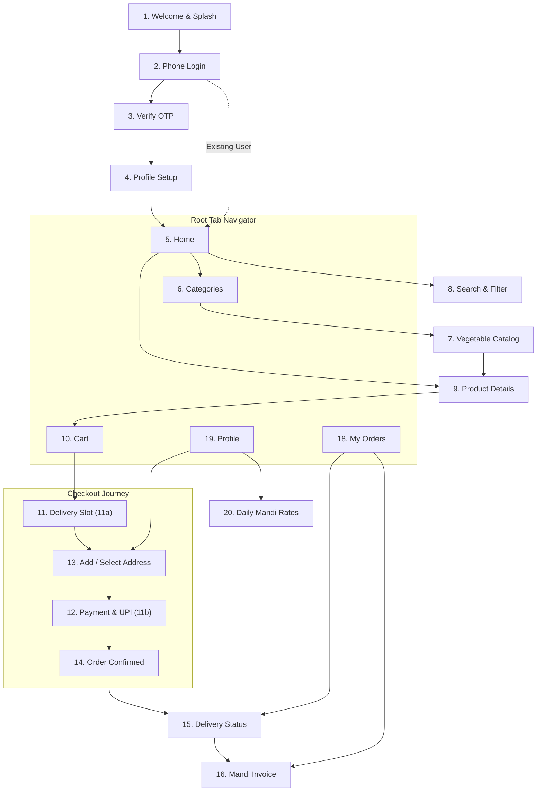

# Screen Specifications: Balaji Fresh Delivery App
**Stitch Project ID:** `8350282291516773685`  
**Platform:** Expo React Native (iOS & Android)

This document provides complete, implementation-ready specifications for all 20 distinct screens designed in Google Stitch.

---

## Screen Inventory Overview

| # | Screen Key | Route Path | Header Type | Footer / Bottom Action | Primary Data Entities |
|---|---|---|---|---|---|
| 1 | `WelcomeScreen` | `app/(auth)/welcome.tsx` | Minimal transparent | Full-width "Get Started" CTA | Welcome slides, Language switch |
| 2 | `PhoneLoginScreen` | `app/(auth)/login.tsx` | Logo + Language | "Get OTP" + WhatsApp login | Phone number, Country code |
| 3 | `OtpVerifyScreen` | `app/(auth)/otp.tsx` | Back button | "Verify & Proceed" CTA | 4-digit code, Resend timer |
| 4 | `ProfileSetupScreen`| `app/(auth)/profile-setup.tsx` | Title only | "Save & Start Shopping" | Name, Household size, Language |
| 5 | `HomeScreen` | `app/(tabs)/index.tsx` | HeaderBar (Location + Slot) | 5-Tab Bar + Sticky Cart | Categories, Products, Ticker, Free delivery bar |
| 6 | `CategoriesScreen` | `app/(tabs)/categories.tsx`| HeaderBar | 5-Tab Bar | 7 Aisles, Produce count, Price start |
| 7 | `CatalogScreen` | `app/catalog.tsx` | HeaderBar + Back | 5-Tab Bar + Sticky Cart | Filtered vegetables, Sort dropdown, Steppers |
| 8 | `SearchScreen` | `app/search.tsx` | Search bar + Voice Mic | 5-Tab Bar | Query, Recent tags, Filter chips, Results |
| 9 | `ProductDetailScreen`| `app/product/[id].tsx` | Back + Share + Wishlist | Sticky "Add to Basket" Bar | High-res image, Harvest time, 4 Weight packs |
| 10| `CartScreen` | `app/(tabs)/cart.tsx` | HeaderBar | 5-Tab Bar + Sticky "Place Order" | Cart items, Free gift, Bill summary, Payment radio |
| 11| `DeliverySlotScreen`| `app/checkout/slot.tsx` | Modal Back | "Continue to Payment" CTA | Date tabs, Morning/Evening slots, Cutoff timer |
| 12| `PaymentScreen` | `app/checkout/payment.tsx`| Back + Security seal | "Pay Now / Confirm Order" | UPI apps (GPay/PhonePe), Cards, COD |
| 13| `AddAddressScreen` | `app/address/add.tsx` | Back + GPS trigger | "Save & Deliver Here" | Pin map, Flat/Building, Tag pills (Home/Work) |
| 14| `OrderConfirmedScreen`| `app/order/confirmed.tsx` | Done checkmark | "Track Morning Delivery" CTA | Order ID, Slot lock status, Items packed |
| 15| `DeliveryTrackingScreen`| `app/order/track/[id].tsx`| Back + Support call | Sticky Guard Note Bar | 4-step vertical tracker, Driver Ramesh Kumar, Van HR 26 |
| 16| `InvoiceScreen` | `app/order/invoice/[id].tsx`| Back + Print/Download | Download PDF action | Tax breakdown, Zero-rated Mandi slip |
| 17| `OrdersListScreen` | `app/(tabs)/orders.tsx` | HeaderBar | 5-Tab Bar | Active order card, Past orders, Reorder CTA |
| 19| `ProfileScreen` | `app/(tabs)/profile.tsx` | HeaderBar | 5-Tab Bar | Saved addresses, Language switch, Helpline |
| 20| `MandiRatesScreen` | `app/mandi-rates.tsx` | Back + Refresh | WhatsApp Mandi Helpline | Wholesale price list, Yesterday vs Today delta |

---

## Detailed Screen Specifications

### 1. Welcome & Splash (`WelcomeScreen`)
- **Stitch ID:** `4fec4db92a3d412a88775a39830a10f1`
- **Purpose:** First app launch experience introducing Balaji Fresh.
- **Layout & Elements:**
  - Full-screen soft background (`#F8FAF5`).
  - Hero image: Morning harvest vegetables in natural dawn sunlight.
  - Heading: "Farm-Fresh Mornings, Direct Wholesale Rates".
  - Subtitle: "Handpicked at 4:30 AM from local mandi and delivered straight to your kitchen by 8:00 AM."
  - 3 Value pillars with botanical icons:
    - Zero Cold Storage: Direct harvest to kitchen.
    - 100% Tare Digital Weight: Verified scales at your doorstep.
    - Early Morning Slot: Guaranteed 8:00 AM - 12:00 PM delivery.
  - Senior-friendly language toggle: English / ગુજરાતી.
  - Primary button: "Get Started" (`#2E7D32` background, 52px height).

### 2. Phone Login (`PhoneLoginScreen`)
- **Stitch ID:** `5be70aa686bf4293a8685870a77d1028`
- **Purpose:** Frictionless phone-number-based onboarding without passwords.
- **Layout & Elements:**
  - Header with Balaji leaf emblem and senior language switch.
  - Morning Mandi Banner with daily update badge.
  - Friendly greeting: "Namaste! Welcome to Balaji".
  - Phone input container:
    - Left slot: Indian flag emoji `🇮🇳` + `+91` code with vertical separator.
    - Input: Formats automatically into 5-5 chunks (`98765 43210`), numeric keypad.
    - Validation icon: Green checkmark `check_circle` pops up upon entering 10 valid digits.
  - Trust message: "We will send a 4-digit SMS OTP for instant verification. No password required."
  - CTA Button: "Get OTP / Continue" with forward arrow.
  - Divider: "OR" with horizontal lines.
  - Secondary CTA: "Continue with WhatsApp" featuring green chat icon.
  - Trust footer: "Trusted by 14,000+ local families • Fresh Daily Harvest".

### 3. Verify OTP (`OtpVerifyScreen`)
- **Stitch ID:** `fa01ef53c5fa42f997863133502eeafb`
- **Purpose:** SMS code confirmation.
- **Layout & Elements:**
  - Back navigation button.
  - Header: "Verify OTP" and "Code sent to +91 98765 43210".
  - 4 large distinct digit input cells with 16px border radius, high-contrast active border (`#0D631B`).
  - Auto-advance on input and backspace-aware focus.
  - Timer: "Resend OTP in 0:42".
  - Primary Button: "Verify & Proceed".

### 4. Customer Profile Setup (`ProfileSetupScreen`)
- **Stitch ID:** `7726a3eb301948f6b7d5aafbbb854a5a`
- **Purpose:** Collect essential user details on first login.
- **Layout & Elements:**
  - Full Name `TextInput`.
  - Preferred Language selector (English, ગુજરાતી, हिन्दी).
  - Household Size pill selector (`1-2 Members`, `3-4 Family`, `5+ Joint Family`).
  - Save & Continue button that directs straight to `HomeScreen`.

### 5. Home - Fresh Morning Delivery (`HomeScreen`)
- **Stitch ID:** `1b45ea095c1346549c6dbc781a6be792`
- **Layout & Sections (Top to Bottom):**
  1. **HeaderBar:**
     - Left: Leaf logo + "Balaji Fresh".
     - Center: Location pill ("Delivering to Sector 14, Gurugram" + expand icon).
     - Right: User avatar with green status ring.
     - Bottom strip: "🌅 Next Delivery: Tomorrow 8:00 AM - 12:00 PM | EARLY FRESH".
  2. **Delivery Progress Card:**
     - Delivery truck icon, "Free Delivery above ₹249", progress track showing `₹180 / ₹249` (72%).
  3. **Search & Voice Bar:**
     - Search input ("Search farm fresh veggies...").
     - Mic button (Voice search trigger) + Tune button (Quick filter sheet).
  4. **Daily Mandi Rates Ticker:**
     - Green gradient banner (`#0D631B` to `#2E7D32`), trending down icon, "Today's Mandi Fresh Rates - Direct Wholesale Savings - Updated 6:00 AM".
  5. **Mandi Aisles Carousel:**
     - Circular category thumbnails: Daily Essentials (Aloo, Pyaz), Leafy Greens (Palak, Methi), Gourds (Lauki, Bhindi), Root Veggies (Gajar, Mooli), Salad & Exotics (Broccoli, Lemon).
  6. **Today's Fresh Picks (2-Column Grid):**
     - Produce cards:
       - Card 1: Fresh Hybrid Tomatoes (`₹38/kg`, 15% OFF, weight pills: 1kg, 500g, 2kg).
       - Card 2: Farm Red Onions (`₹32/kg`, Nashik Grade A, weight pills: 1kg, 2kg, 5kg).
       - Card 3: Tender Green Bhindi (`₹42/500g`, Harvested 4 AM, weight pills: 250g, 500g, 1kg).
       - Card 4: Desi Palak Bunch (`₹24/bunch`, Washed & Cleaned, bunch pills: 1 Bunch, 2 Bunches).
     - Weight selector pills on each card.
     - Transforming button: Green "ADD" transitions smoothly to `(-) qty (+)` stepper.
  7. **Balaji Freshness Pledge:**
     - 3-column trust badge: Zero Cold Storage, Direct Wholesale, Hand-Sorted 3-step QC.
  8. **Sticky Floating Basket Bar:**
     - Displays "3 Items • ₹180 Total | Add ₹69 for Free Delivery" + "View Basket →".
  9. **Fixed Bottom Tab Bar:**
     - Home (active), Categories, Cart (badge: 3), Orders, Profile.

### 6. Categories Directory - Mandi Aisles (`CategoriesScreen`)
- **Stitch ID:** `3030084223384aecbcb11212731b7a6a`
- **Purpose:** Full visual directory of all 7 wholesale vegetable aisles.
- **Aisles Listed:**
  1. Daily Kitchen Essentials (Aloo, Pyaz, Tamatar, Adrak, Lehsun) - From ₹18/kg.
  2. Green Leafy Veggies & Saag (Palak, Methi, Sarson, Bathua, Dhaniya) - From ₹12/bunch.
  3. Gourds & Cucurbits (Lauki, Tori, Karela, Tinda, Kheera) - From ₹24/kg.
  4. Seasonal & Exotic Veggies (Broccoli, Baby Corn, Mushrooms, Zucchini) - From ₹45/pack.
  5. Pods & Beans (Green Matar, French Beans, Sem Fali, Guar Phali) - From ₹32/500g.
  6. Salad & Farm Roots (Gajar, Mooli, Chukandar, Nimbu, Mirch) - From ₹15/kg.
  7. Pre-cleaned & Cut Combos (Sambar Cut, Stew Mix, Peeled Garlic) - From ₹39/pack.
- **Footer:** Direct Procurement Stat Box (0% Cold Storage, 4:30 AM Procurement, 100% Digital Tare Scale).

### 7. Vegetable Catalog & Daily Rates (`CatalogScreen`)
- **Stitch ID:** `69646d2e2ce9494585f8dfe14c1c84d2`
- **Purpose:** Category product listings with sort/filter controls.
- **Layout & Elements:**
  - Search & voice assist strip.
  - Horizontal category chips (All, Leafy Greens, Daily Staples, Exotic, Herbs).
  - Wholesale rates banner.
  - Sort selector dropdown: Popularity, Price: Low to High, Freshness First.
  - Product rows with image thumbnail, dual name, wholesale price, weight pills, and quantity stepper.
  - Sticky bottom floating cart preview bar.

### 8. Search & Filter - Fresh Vegetables (`SearchScreen`)
- **Stitch ID:** `b9641a25e4e24da797e7634729d77083`
- **Purpose:** High-speed product discovery.
- **Layout & Elements:**
  - Top search input with clear button and active voice search state.
  - Recent search pills ("Palak", "Desi Tamatar", "Nashik Pyaz").
  - Quick filter chips: "Harvested Today", "Under ₹30", "Organic", "Leafy".
  - Search results matching items with price highlights.

### 9. Product Details - Fresh Tomatoes (`ProductDetailScreen`)
- **Stitch ID:** `de8395162f8a4530bb1e7df9044929ed`
- **Purpose:** In-depth vegetable breakdown and portion selection.
- **Layout & Elements:**
  - Top navigation bar: Back arrow, Share button, Wishlist heart button.
  - 1:1 Aspect ratio square hero photo.
  - Badges on photo: "Harvested Today 4:30 AM" and "Daily Mandi Rate".
  - Titles: "Desi Hybrid Red Tomatoes" + Gujarati subtitle "દેશી હાઇબ્રિડ ટામેટાં" + "A-Grade" tag.
  - Pricing row: `₹38 / 1 kg`, MRP `₹45` strikethrough, "Save ₹7 per kg today".
  - Fresh Harvest Guarantee box.
  - 4 Weight Pack Cards:
    - `250g`: Small daily curry - ₹10
    - `500g`: 2-3 member meal - ₹19
    - `1 kg`: Standard family pack (Popular default) - ₹38
    - `2 kg`: Puree & weekly stock (Save ₹2 extra) - ₹74
  - Stepper Quantity Selector: Number of packets (1 packet of 1 kg).
  - Guaranteed Morning Delivery card (`Tomorrow 8:00 AM - 12:00 PM`).
  - Mandi Sourcing & Freshness: Direct Farmer Network (Haryana & Delhi NCR), Grade-A Quality Check, Ventilated Paper Bag packaging.
  - Sticky Bottom Tray: Final calculated price (`₹38 / 1 kg`) + "Add to Morning Basket" 48px button.

### 10. Cart & Easy Checkout (`CartScreen`)
- **Stitch ID:** `ed28049ddd73455cb841a170b44d24b0`
- **Purpose:** Basket review, slot verification, and 1-tap checkout.
- **Layout & Elements:**
  - HeaderBar.
  - Free Delivery Unlocked banner (`₹0 Delivery`).
  - Guaranteed Slot Card (`Tomorrow Morning, 8:00 AM – 12:00 PM`).
  - Delivery Address Card with "Change" button.
  - Itemized Fresh Basket:
    - Item 1: Farm Fresh Hybrid Tomato (1 kg, ₹38).
    - Item 2: Desi Palak (2 bunches, ₹48).
    - Item 3: Fresh Green Bhindi (500g, ₹42).
    - Item 4: Plump Green Peas (1 kg, ₹110).
    - Item 5: Complimentary Gift - *Dhaniya & Hari Mirch Pack* (FREE, Balaji Shagun).
  - Bill Summary Card: Item total (₹238), Packing & sorting (FREE), Delivery fee (FREE), Total payable (`₹238`).
  - Payment Mode Quick Select: UPI (default selected), Online Payment, Cash on Delivery.
  - Quality guarantee banner (100% Dew Fresh, Precise Weights, Doorstep Return).
  - Sticky bottom action: "Place Order • ₹238" button.

### 11. Delivery Slot & Schedule (`DeliverySlotScreen`)
- **Stitch ID:** `3cf7d2b8e07643d28ddc8c78237817bc`
- **Purpose:** Dedicated slot selection.
- **Layout & Elements:**
  - Date horizontal tabs: Today, Tomorrow, Day After Tomorrow.
  - Slot 1: Early Morning (`8:00 AM - 12:00 PM`) - "Dawn Harvested Lot".
  - Slot 2: Evening Fresh (`4:00 PM - 8:00 PM`).
  - Slot cutoff notice: "Book before 11:00 PM for morning harvest run".
  - Contactless doorbell handover toggle switch.

### 12. Payment Method & UPI (`PaymentScreen`)
- **Stitch ID:** `0047984ea65d48d4b4ca50fa2c2c65d0`
- **Purpose:** Payment gateway and UPI selection.
- **Layout & Elements:**
  - Order amount summary (`₹238`).
  - Instant UPI Apps grid: Google Pay, PhonePe, Paytm, BHIM, Cred.
  - Custom UPI ID input (`username@okaxis`) with "Verify VPA".
  - Debit/Credit card accordion.
  - Cash on Delivery option with "Pay digitally or cash upon arrival".
  - 100% Secure Transaction bank badge.

### 13. Add Delivery Address (`AddAddressScreen`)
- **Stitch ID:** `fceab825a57f4e6b93ca35f5919bd69a`
- **Purpose:** Pin location and save address details.
- **Layout & Elements:**
  - "Use My Current GPS Location" button.
  - House / Flat / Block No input.
  - Apartment / Society Name input.
  - Street / Area input.
  - Landmark input.
  - Pincode & City auto-fill.
  - Address tag pills: `Home`, `Work`, `Parents`, `Other`.
  - Default address checkbox.
  - "Save & Deliver Here" CTA.

### 14. Order Placed & Confirmed (`OrderConfirmedScreen`)
- **Stitch ID:** `b5914f7334d7499f84d16e4aa387ba06`
- **Purpose:** Immediate reassurance post-purchase.
- **Layout & Elements:**
  - Animated green checkmark badge.
  - "Order Confirmed!" - Order `#BE-89421`.
  - Confirmed Delivery Slot: Tomorrow Morning, 8:00 AM - 12:00 PM.
  - Harvest matching status: "Your produce has been assigned to morning harvest lot #4".
  - Summary of 5 items packed.
  - Primary CTA: "Track Morning Delivery".
  - Secondary CTA: "Back to Home".

### 15. Live Morning Delivery Tracking (`DeliveryTrackingScreen`)
- **Stitch ID:** `2619b3126a144e37a00a64fcc0baac97`
- **Purpose:** Live morning delivery status and driver contact.
- **Layout & Elements:**
  - Order identifier `#BE-89421` with verified badge.
  - 4-Stage Vertical Progress Stepper:
    1. Order Confirmed (Today 7:15 PM) - Completed.
    2. Mandi Sorting & Quality Check (Active now, 5:00 AM) - Pulsing orange badge.
    3. Out for Doorstep Delivery (8:15 AM) - Upcoming van icon.
    4. Delivered & Tare-Weighed at Door - Upcoming scale icon.
  - 100% Mandi Tare Weight Guarantee Card.
  - Assigned Delivery Partner Card:
    - Photo of driver Ramesh Kumar.
    - Verified partner badge + 4.9 star rating (1,420+ morning trips).
    - Van details: `HR 26 EA 4022` (Insulated Crate Van).
    - 2 Action buttons: "Call Partner" and "WhatsApp Support".
  - Produce in Crate item preview list.
  - Collapsible Guard Instructions Sheet ("Leave with Tower B security guard").

### 16. Order Invoice & Mandi Bill (`InvoiceScreen`)
- **Stitch ID:** `3aa69ab0988042109b8d085954b72b89`
- **Purpose:** Transparent tax-compliant mandi bill.
- **Layout & Elements:**
  - Balaji Fresh letterhead, GSTIN, FSSAI numbers.
  - Customer name and delivery address.
  - Itemized table: Item, Net weight, Rate/kg, Mandi discount, Final price.
  - Zero-rated produce tax summary (Exempt fresh vegetable category).
  - Total savings callout (₹44 saved).
  - "Download PDF Invoice" button.

### 17. My Orders & Morning Status (`OrdersListScreen`)
- **Stitch ID:** `1c531bac0f5f42fc98175b1a04fd2404`
- **Purpose:** View active and past orders.
- **Layout & Elements:**
  - Tab selector: `Active Orders (1)` vs `Past Deliveries`.
  - Active Order Card with live status pill ("Sorting at Mandi Hub"), estimated arrival, and "Track Order" button.
  - Past Order Cards: Date, item count, total price, "Download Invoice" button, and 1-tap "Reorder Morning Basket" button.

### 19. Profile & Delivery Addresses (`ProfileScreen`)
- **Stitch ID:** `dff0d80d5a13481cb4de1b4f5172e36c`
- **Purpose:** User account and address book management.
- **Layout & Elements:**
  - User avatar, name, verified mobile number.
  - Saved Addresses list (Home, Work, Parents) with Edit/Delete options and "Add New Address" CTA.
  - Language settings modal trigger (English / Gujarati / Hindi).
  - WhatsApp Morning Alert notification toggle.
  - Customer Support direct line button.
  - App version and Logout button.

### 20. Daily Mandi Rates & Support (`MandiRatesScreen`)
- **Stitch ID:** `8c8c40aea0354ae29895a66b73cb1021`
- **Purpose:** Wholesale rate transparency and customer helpdesk.
- **Layout & Elements:**
  - Live wholesale rate board updated daily at 6:00 AM.
  - Table: Produce, Today's Rate, Yesterday's Rate, Mandi arrival volume.
  - Digital weighing scale explanation and tare verification FAQ.
  - 1-tap WhatsApp Support chat link.

---

## Screen Navigation Mapping

